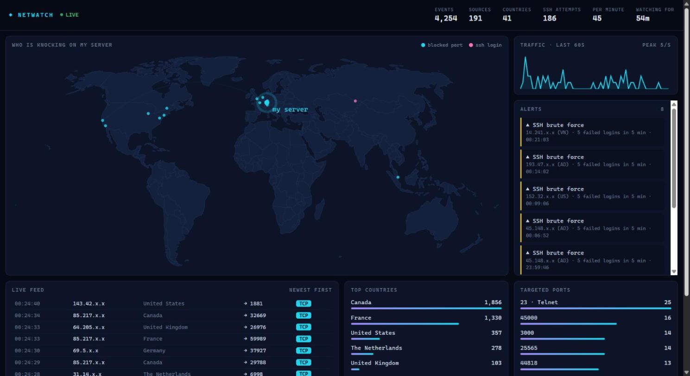
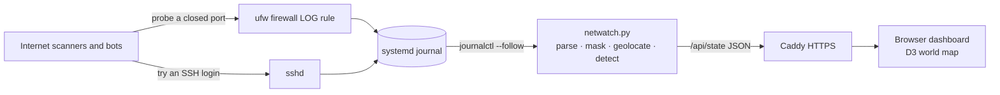

# NetWatch — Live Attack Map

A live dashboard showing who on the internet is knocking on my server: blocked port probes, port scans and SSH brute-force attempts, plotted on a world map as they happen.

**Live demo:** https://netwatch.pubnetwork.in



## Why

Any server with a public IP is scanned within minutes of going online. Bots sweep the whole IPv4 space looking for open databases, remote desktops and weak SSH passwords. NetWatch makes that invisible background noise visible, using nothing but the logs Linux already keeps.

## How it works



1. The firewall drops every connection to a port that isn't open, and a `LOG` rule records it in the kernel log.
2. `sshd` records every failed login.
3. `netwatch.py` follows both through the systemd journal, masks each source IP, looks up its rough location in an offline GeoIP database, and runs the detection rules.
4. The browser polls a small JSON snapshot every two seconds and animates new events as arcs flying towards the server.

| Detection | Rule |
| --- | --- |
| Port scan | One source hits 10+ different closed ports within 10 seconds |
| SSH brute force | One source fails 5+ SSH logins within 5 minutes |
| Targeted ports | Running count of which services bots look for most |

Alerts mean *worth a look*, not *proven attack*. Each source alerts at most once per 10 minutes.

## Privacy by design

- **Only unsolicited traffic is recorded.** Connections to services that are actually running are accepted by the firewall before the log rule, so real users of the server never appear.
- **Source IPs are masked** (`45.83.x.x`) before they leave the collector. Full addresses live only in memory for the detection windows.
- **No packet contents, no usernames, no service names.** The page never reveals what runs on the server.
- **No database.** Stats reset when the service restarts.

## Security of the dashboard itself

- Runs as a throwaway `DynamicUser` under systemd with no capabilities, a read-only filesystem and a 200 MB memory cap. It only needs to read the journal.
- Listens on `127.0.0.1` only; Caddy terminates HTTPS in front of it.
- Read-only: the only routes are `/`, `/app.js` and `/api/state`.
- Strict Content-Security-Policy, Subresource Integrity on CDN scripts, and all data rendered with `textContent`, never as HTML.
- The JSON snapshot is cached per second, so heavy traffic to the page costs almost nothing.

## Run it locally

Works on Windows, macOS or Linux. Demo mode generates synthetic traffic instead of reading real logs.

```bash
pip install -r requirements.txt
curl -L https://download.db-ip.com/free/dbip-city-lite-2026-11.mmdb.gz | gunzip > dbip-city-lite.mmdb
python netwatch.py --demo
```

Open http://127.0.0.1:8088. Without the `.mmdb` file everything still works, but nothing is placed on the map.

Run the checks with `python test_netwatch.py`.

## Deploy on a VPS

Target: Ubuntu or Debian with `ufw`.

**1. Log blocked connections.** Add this line to `/etc/ufw/after.rules` (and the same to `/etc/ufw/after6.rules` for IPv6), just above the final `COMMIT`:

```
-A ufw-after-input -m limit --limit 20/second --limit-burst 100 -j LOG --log-prefix "[NETWATCH] "
```

ufw's own logging is limited to 3 entries per minute, which is too slow for a live map, so this rule replaces it:

```bash
sudo ufw logging off
sudo ufw reload
sudo journalctl -k -f | grep NETWATCH
```

**2. Install the collector.**

```bash
sudo git clone https://github.com/<you>/netwatch /opt/netwatch
cd /opt/netwatch
sudo python3 -m venv .venv
sudo .venv/bin/pip install -r requirements.txt
curl -L https://download.db-ip.com/free/dbip-city-lite-$(date +%Y-%m).mmdb.gz | gunzip | sudo tee dbip-city-lite.mmdb > /dev/null
sudo cp deploy/netwatch.service /etc/systemd/system/
sudo systemctl daemon-reload
sudo systemctl enable --now netwatch
curl -s 127.0.0.1:8088/api/state | head -c 300
```

Set `--home` in the service file to your server's latitude and longitude.

**3. Put it behind HTTPS.** Point a subdomain at the server and use `deploy/Caddyfile`, or with nginx:

```nginx
location / { proxy_pass http://127.0.0.1:8088; }
```

If Caddy runs in Docker, `127.0.0.1` inside the container is the container itself. Bind NetWatch to the Docker bridge instead and let only containers reach it:

```bash
ip -4 addr show docker0
sudo ufw allow in from 172.16.0.0/12 to 172.17.0.1 port 8088 proto tcp
```

The shipped service file already uses `--host 172.17.0.1`. With Caddy or nginx installed directly on the host, change it to `--host 127.0.0.1`. Give the Caddy container `extra_hosts: ["host.docker.internal:host-gateway"]` in its compose file, then:

```
netwatch.example.com {
	reverse_proxy host.docker.internal:8088
}
```

Ports published by Docker skip the host's `INPUT` chain, so traffic to containers never reaches the NetWatch log rule. That keeps real users out of the data, but it also means ufw does not protect those ports.

## Server hardening checklist

Do this before sharing the link, since the dashboard advertises the server.

- [ ] SSH keys only: `PasswordAuthentication no` and `PermitRootLogin prohibit-password` in `sshd_config`
- [ ] `ufw default deny incoming`, then allow only the ports you actually use
- [ ] `unattended-upgrades` enabled for automatic security patches
- [ ] Port `8088` is not reachable from outside (it binds to `127.0.0.1` by default)
- [ ] Refresh the GeoIP database monthly

## What I learned

- How a stateful firewall decides what to accept, and how to log what it drops with netfilter `LOG` rules
- What real internet background noise looks like: which ports bots target and how fast
- Reading `sshd` authentication logs and the systemd journal
- IP geolocation and its limits (it locates networks, not people)
- Sandboxing a service with systemd, plus CSP and SRI on the web side
- Treating every log line as untrusted input

## Credits

IP geolocation by [DB-IP](https://db-ip.com) (CC BY 4.0). Map data from [Natural Earth](https://www.naturalearthdata.com) via [world-atlas](https://github.com/topojson/world-atlas). Rendering with [D3](https://d3js.org).
